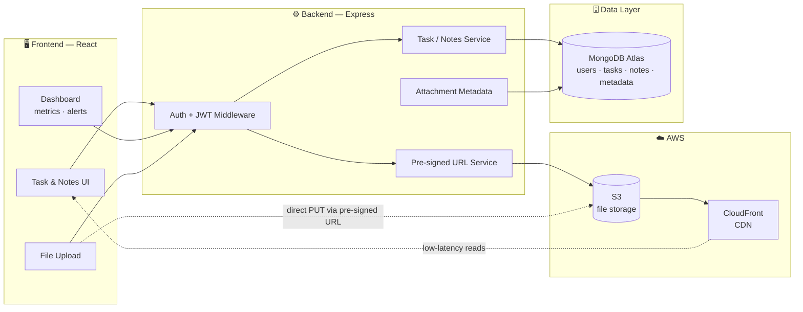
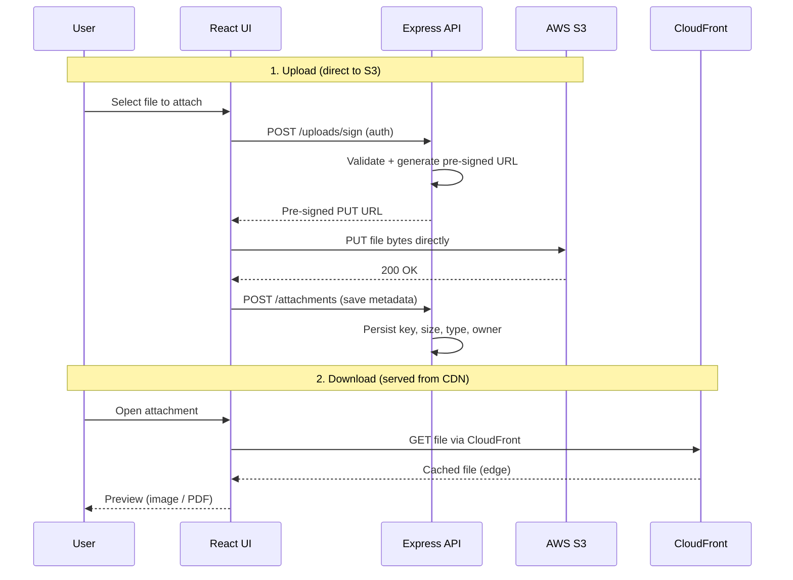
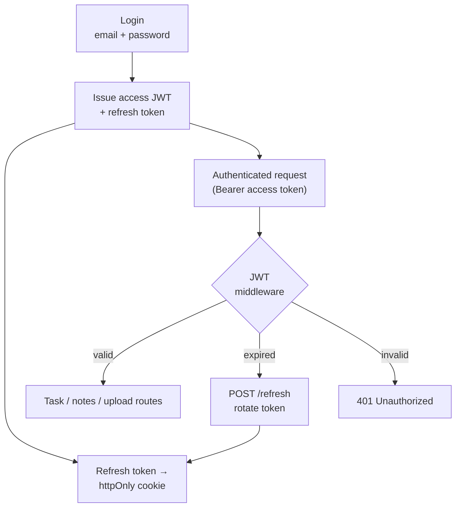

# Cloud Task Manager

Productivity platform for managing tasks, notes, and file attachments — with stateless JWT authentication, secure direct-to-S3 file storage, and global CDN delivery.

**Built with**
`React` · `Node.js` · `Express` · `MongoDB` · `AWS S3` · `CloudFront` · `JWT`

---

## Overview

Cloud Task Manager is a productivity application for organizing tasks, notes, and file attachments in one place. It combines a task/notes workspace with secure cloud file storage — every attachment is uploaded straight from the browser to AWS S3 and served back through a CloudFront CDN for low-latency global delivery.

Authentication is fully stateless: the server holds no session state, relying instead on short-lived JWTs paired with rotating refresh tokens stored in `httpOnly` cookies. This keeps the backend horizontally scalable while keeping tokens out of reach of client-side JavaScript.

---

## System Architecture

The browser never streams file bytes through the backend. The Express server only issues **pre-signed URLs**; the actual upload goes directly from the client to S3, and downloads are served from CloudFront's edge — keeping the API lightweight and the transfer fast.

---

## The File Upload Pipeline

Attachments are uploaded direct-to-S3 using pre-signed URLs, so large files never pass through the application server. The backend's only job is to authorize the request, mint a scoped URL, and record metadata once the upload completes.

### Why pre-signed URLs?

Routing file bytes through the API server wastes bandwidth, adds latency, and makes the backend a bottleneck for large uploads. Pre-signed URLs let the client talk to S3 directly with a time-limited, permission-scoped credential — so the server stays stateless and cheap, while uploads scale with S3 rather than with the app tier.

---

## Security & Access Control

Every protected request passes through JWT-based auth middleware. Access tokens are short-lived; a rotating refresh token — stored in an `httpOnly` cookie — issues new access tokens without re-prompting the user, and cannot be read by client-side scripts.

**Refresh token rotation** means each refresh issues a new token and invalidates the old one — so a stolen refresh token has a narrow window of use and can be detected if replayed.

---

## Features

- **Task lists** with due dates, priorities, and tags
- **Rich text notes** with markdown support
- **File attachments** with inline preview for images and PDFs
- **Dashboard** with productivity metrics and overdue-task alerts
- **Secure cloud storage** — direct-to-S3 uploads, CDN-backed downloads

---

## Stack

| Layer          | Technology                                                    |
| -------------- | ------------------------------------------------------------- |
| **Frontend**   | React, React Router, markdown rendering, chart components     |
| **Backend**    | Node.js, Express, JWT auth middleware                         |
| **Database**   | MongoDB Atlas (users, tasks, notes, attachment metadata)      |
| **Storage**    | AWS S3 with pre-signed URLs for direct browser uploads        |
| **CDN**        | AWS CloudFront for global, low-latency file delivery          |
| **Auth**       | JWT access tokens + rotating refresh tokens (`httpOnly` cookies) |

---

## Infrastructure

Deployed on AWS with S3 for object storage, CloudFront for edge delivery, and MongoDB Atlas as the managed database. The Express backend handles authentication middleware, pre-signed URL orchestration, attachment metadata, and task/notes CRUD — while keeping file bytes off the application server entirely.

---

## Key Takeaways

- **Stateless by design** — JWT + refresh rotation means no server-side sessions and easy horizontal scaling.
- **Direct-to-S3 uploads** — the API issues pre-signed URLs; large files bypass the app tier completely.
- **CDN-backed delivery** — CloudFront serves attachments from the edge for low global latency.
- **Security-first auth** — `httpOnly` refresh cookies and token rotation keep credentials out of JavaScript's reach.
